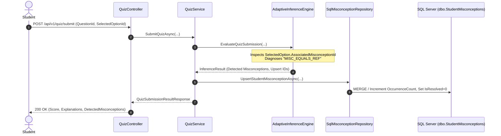

# ADR-002: Misconception Diagnosis via Distractor Mapping (Buggy Rules)

## Status
**Accepted**

## Context
A cornerstone of intelligent tutoring systems (ITS) is **Misconception Detection**, thus what the assignment requires.

Merely informing a learner that their answer is incorrect provides insufficient pedagogical value. An effective adaptive platform must determine *why* the student erred, isolate the underlying mental bug (buggy rule), and provide targeted remediation.

## Decision
We implemented a **distractor-to-misconception mapping architecture**:
1. **Canonical Misconception Catalog**: Seeded in `dbo.Misconceptions` with predefined codes (`MISC_EQUALS_REF`, `MISC_PASS_BY_REF`, `MISC_ARRAY_BOUNDS`, `MISC_STATIC_INSTANCE`, `MISC_INT_DIVISION`).
2. **Pedagogical Distractors**: Each multiple-choice question contains wrong options specifically constructed to reflect one of these misunderstandings, linked via `QuestionOptions.AssociatedMisconceptionId`.
3. **Automated Diagnostic Evaluation**:
   - When a student picks a distractor tagged with a misconception, `AdaptiveInferenceEngine` triggers an upsert to `dbo.StudentMisconceptions`, incrementing `OccurrenceCount` and recording `LastOccurredAt`.
   - The API immediately returns a `DetectedMisconceptionDto` with diagnostic explanation and corrective advice.
   - An automated `Recommendation` is created urging the student to review the lesson covering that topic.
4. **Cognitive Resolution (Mastery)**:
   - When a student subsequently answers a related question correctly, the engine detects that the distractors belong to previously active misconceptions and sets `IsResolved = true`.

## Consequences

### Benefits
- **Immediate Formative Feedback**: Students receive targeted corrections at the moment of cognitive dissonance.
- **Persistent Cognitive Tracking**: The system builds a cumulative profile of recurring weaknesses rather than transient test scores.
- **Idempotent Data Mutation**: Utilizes SQL `MERGE` to cleanly handle first-time occurrences vs. repeat mistakes.

### Trade-offs
- Quiz authors must carefully engineer distractors so that incorrect choices map cleanly to distinct misconceptions rather than arbitrary mistakes.
