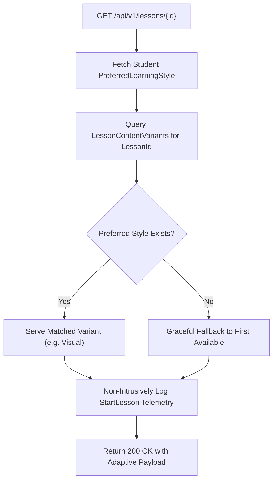

# ADR-004: Adaptive Multi-Variant Content Delivery by Learning Style

## Status
**Accepted**

## Context
A primary requirement of the assignment is catering to differing student learning styles (*"Προτιμήσεις μάθησης (π.χ. οπτικός τρόπος)"* and *"Δημιουργία προσαρμοστικών μαθημάτων και διδακτικού υλικού"*). Different learners grasp complex object-oriented programming concepts through different modalities:
- **Visual Learners**: Benefit from memory diagrams, stack/heap layouts, ASCII flowcharts, and sequence visualizations.
- **Practical Learners**: Benefit from runnable code snippets, live debugging experiments, and actionable syntax recipes.
- **Conceptual Learners**: Benefit from architectural theory, analogies, and design principles.

## Decision
We implemented a **Multi-Variant Adaptive Lesson Model**:
1. **Schema**: The `dbo.LessonContentVariants` table maintains separate markdown bodies and optional image URLs for each lesson keyed by `(LessonId, Style)`.
2. **Dynamic Content Resolution**:
   When `LessonsController.GetLessonById` is requested:
   - The system inspects the authenticated student's `PreferredLearningStyle`.
   - `SqlLessonRepository` queries available variants and selects the one matching the student's preference.
   - If a specific variant style has not yet been authored for that lesson, the engine gracefully falls back to the primary available variant rather than failing.
   - The response includes `AvailableStyles` so the frontend UI can optionally offer an in-lesson switcher.
3. **Non-Intrusive Telemetry Tracking**:
   Opening a lesson automatically logs a `StudentInteraction` record of type `StartLesson` with the adaptive style delivered.

## Consequences

### Benefits
- **Zero Content Redundancy in Core Lesson**: Metadata (Title, Summary, Difficulty, OrderIndex) is normalized in `dbo.Lessons`, while instructional payloads vary flexibly in `dbo.LessonContentVariants`.
- **Extensible Modalities**: Adding additional styles (e.g., Auditory, Interactive) requires no schema modifications, only inserting new enum-keyed rows.
- **Enhanced Student Engagement**: Learners consume content tailored to their cognitive preference.

### Trade-offs
- Curriculum authors must write up to three versions of instructional text per lesson topic.
